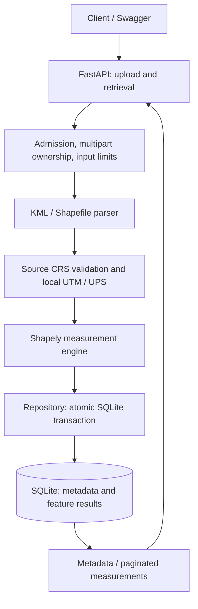

# Geospatial File Measurement API

FastAPI backend for AEREO's geospatial assignment: upload KML or one zipped
Shapefile, retrieve persisted metadata, and inspect geometry, attributes and
metric area/length per feature. Polygon and line measurements use a local UTM/UPS
projection; valid points are retained without a measurement. Invalid features
have explicit outcomes alongside good ones. This is a bounded local evaluation
service, not a survey-certified or production deployment.

## Key features

- KML 2.2 and a ZIP containing one Shapefile dataset.
- Polygon/MultiPolygon area and LineString/MultiLineString length.
- Point/MultiPoint handling without invented measurements.
- Source geometry, feature ID/index, attributes, source CRS and measurement CRS.
- Persistent metadata/results, paginated retrieval and explicit feature errors.
- Bounded uploads, archive checks, safe XML parsing and automatic temporary cleanup.
- OpenAPI/Swagger, automated tests, Docker and a CI workflow.

## Architecture overview



Valid Point/MultiPoint bypass local measurement projection. Parsing and
measurement run in a worker thread; a 201 response follows the committed write.

## Quick start

From the repository root, with Python 3.12 (the validated version):

```bash
python3.12 -m venv .venv
source .venv/bin/activate
python -m pip install -r requirements-dev.lock
uvicorn app.main:app --reload
```

Use Python 3.12 to reproduce the tested environment exactly. No database server
or account credentials are required. The database is created on first startup.
On Windows, activate with `.venv\Scripts\activate`.
For a runtime-only install, use `requirements.lock` instead.

Open Swagger at **http://127.0.0.1:8000/docs**. ReDoc is `/redoc`; the schema is
`/openapi.json`. Swagger includes a required binary `file` field and typed responses.

## API documentation and sample requests

Success responses are resource objects; errors use a consistent `error` object.
Upload with exactly one multipart file field **`file`**, without other fields. MIME types are not trusted; the selected
parser validates content as well as the filename extension.

| Method | Endpoint | Result |
| --- | --- | --- |
| POST | `/api/files/` | Process synchronously; 201 with metadata and `Location` header |
| GET | `/api/files/{id}/` | 200 with persisted file metadata |
| GET | `/api/files/{id}/measurements/` | 200 with paginated feature results |
| GET | `/health/` | 200 when the database can be queried |

```bash
curl -sS -F 'file=@examples/polygon.kml' http://127.0.0.1:8000/api/files/
curl -sS -F 'file=@examples/sample_shapefile.zip' http://127.0.0.1:8000/api/files/
# Replace FILE_ID with the UUID returned by the upload:
curl -sS http://127.0.0.1:8000/api/files/FILE_ID/
curl -sS 'http://127.0.0.1:8000/api/files/FILE_ID/measurements/?offset=0&limit=100'
```

Example metadata (IDs and timestamps vary):

```json
{
  "id": "ea99d272-94a5-46ef-a9e3-73a2f2f07708",
  "filename": "sample_shapefile.zip",
  "file_type": "shapefile",
  "feature_count": 1,
  "crs": "EPSG:32643",
  "status": "COMPLETED",
  "measured_count": 1,
  "skipped_count": 0,
  "failed_count": 0,
  "created_at": "2026-10-08T12:00:00Z",
  "completed_at": "2026-10-08T12:00:00Z"
}
```

A feature result from that dataset:

```json
{
  "index": 0,
  "feature_id": "0",
  "geometry_type": "Polygon",
  "source_geometry_type": "POLYGON",
  "geometry": {
    "type": "Polygon",
    "coordinates": [[[500000,1900000],[500000,1900100],[500100,1900100],
                     [500100,1900000],[500000,1900000]]]
  },
  "properties": {"label": "synthetic"},
  "source_crs": "EPSG:32643",
  "measurement_crs": "EPSG:32643",
  "status": "MEASURED",
  "area": 10000.0,
  "area_unit": "m²",
  "length": null,
  "length_unit": null,
  "error": null
}
```

The measurements endpoint wraps features in
`{"file_id": "…", "total": 1, "offset": 0, "limit": 100, "features": [...]}`.
`limit` defaults to 100, permits 1–1000, and `offset` must be non-negative.
An offset beyond the total, including very large integers, returns an empty
page without binding the offset to SQLite. Geometry coordinates remain in
the **source CRS**; their JSON shape follows GeoJSON geometry conventions, but a
projected geometry should not be treated as RFC 7946 WGS84 GeoJSON.
KML Placemark IDs are used where present; otherwise the zero-based index is used.
Shapefile IDs and indices are their original zero-based record ordinals. Deleted
DBF rows are omitted: indices may have gaps and `feature_count` counts active
rows. Geometry and attributes are read by the same ordinal, never zipped from
separately filtered iterators. An all-deleted dataset returns `EMPTY_DATASET` (400).
`geometry_type` describes the normalized geometry; `source_geometry_type` retains
the source type (for example `POLYLINEZ` or unsupported `MULTIPATCH`).

## Deterministic demo

The checked-in `examples/` files are synthetic, with one feature each:

| File | Expected outcome |
| --- | --- |
| polygon.kml | MEASURED Polygon; approximately 11,804.99384m² |
| lines.kml | MEASURED LineString; approximately 106.57758m |
| points.kml | NOT_APPLICABLE Point; null measurements |
| sample_shapefile.zip | MEASURED Polygon; exactly 10,000m² in EPSG:32643 |

With the server running, execute `python scripts/demo.py`. It uploads each sample,
fetches its metadata and results, verifies basic consistency, and prints JSON.
Use `--base-url http://127.0.0.1:8000` to choose a server. The workflow creates four
new persisted resources on each run; it does not delete or deduplicate them.
Sample fixtures are tested against these values. Existing `samples/survey.kml`
contains a polygon, line and point for a single-upload mixed-outcome demonstration.
The Shapefile ZIP is intentional format input, not a generated submission archive.

## Architecture and project structure

```text
app/
  main.py                 HTTP routes, limits, exception handlers, startup
  config.py               environment settings
  errors.py               request-level and feature-level errors
  schemas.py              Pydantic API contracts
  uploads.py              multipart ownership and deterministic spool cleanup
  service.py              upload-to-persistence orchestration
  repository.py           SQLite schema and parameterized queries
  geospatial/
    parser.py             bounded ZIP, Shapefile and KML readers
    crs.py                projection selection and cached transformations
    measurements.py       validation, measurement and feature outcomes
tests/                    API, parser/security and measurement tests
examples/                 single-feature polygon, line, point and Shapefile demos
scripts/demo.py           standard-library upload/retrieval demonstration
samples/                  mixed survey and original projected-square fixture
docs/interview-guide.md    code walkthrough and change exercises
```

## Processing flow

The HTTP layer reads a bounded upload and hands processing to a worker thread.
The parser checks the file format and creates features with a source CRS. Each
feature is validated, projected and measured. Metadata and results are inserted
in one transaction, then a 201 response is returned. Retrieval reads only the
requested page. CPU/file work does not run on the async event loop.

Raw uploads are not retained. Starlette may spool multipart content into a
system temporary file. The parser owns and closes every handle in `finally`,
including unfinished parts after malformed input, size rejection, disconnect or
request cancellation. Multi-frame ASGI tests verify closure with disk-backed
spools; cleanup does not depend on garbage collection. The small adapter uses
Starlette 0.52.1's private handle list and must be retested on upgrades.

At most two uploads are admitted per process by default; additional requests get
`PROCESSING_BUSY` (503), before multipart parsing. There is no waiting upload
queue. A cancelled request keeps its slot until the non-cancellable worker thread
finishes. Processing may persist a result after a client disconnects, so the
client may lose its returned ID; retries are not idempotent. ZIP components are
read into bounded memory, never extracted to disk. XML is parsed incrementally:
structure limits apply on start events and completed/irrelevant nodes are cleared.

## Supported formats

| Input | Supported envelope |
| --- | --- |
| KML | KML 2.2 namespace; Point/LineString/Polygon and homogeneous nested MultiGeometry; ExtendedData and SimpleData |
| Shapefile ZIP | One matching SHP/SHX/DBF/PRJ dataset; optional CPG; original record ordinals preserved |
| Measurement | Polygon/MultiPolygon area in m²; LineString/MultiLineString length in m; Point/MultiPoint null |

Unsupported mixed collections, KML Model/gx:Track and Shapefile MultiPatch receive
feature outcomes. KMZ and additional geospatial formats are not accepted.

## CRS handling

KML 2.2 specifies WGS84 longitude/latitude, so its source CRS is EPSG:4326.
A Shapefile must include matching `.shp`, `.shx`, `.dbf` and `.prj` components;
`.cpg` is optional. The `.prj` WKT is parsed using pyproj. Missing CRS is rejected
instead of guessing from coordinate magnitudes.

Projection selection is centralized in `app/geospatial/crs.py`:

Point/MultiPoint only need valid finite XY and a valid transformation to WGS84;
they do not need a local measurement CRS or the extent restrictions below.
For lines and polygons:

1. Transform the feature to WGS84 for location/extent checks, using `always_xy=True`.
2. Reject a longitude or latitude span over 6°. This also rejects typical
   antimeridian crossings rather than treating them as very long segments.
3. Choose the standard UTM zone from the geographic centroid's longitude and
   hemisphere. Wholly polar features use north/south UPS (EPSG:32661/32761).
   Features crossing a UTM/UPS latitude boundary are rejected.
4. Transform the **original geometry** directly into the chosen metric CRS.

The same rule applies to already projected sources: existing UTM coordinates can
remain in that UTM zone, while Web Mercator or feet-based coordinates are
reprojected. A CRS saying “metres” alone does not establish a suitable ground
measurement projection. Different features in one file may use different target
CRSs; each result names its target. Transformers are cached with a bounded cache.
Ballpark datum transformations are disabled, and PROJ network downloads are not
enabled. Unsupported/missing transformation resources become feature errors.

## Measurement methodology

Shapely calculates planar polygon area (holes subtracted, multipart areas summed)
and planar line length (multipart lengths summed) **after projection**.
Results are labelled `m²` or `m`; there is no degrees-to-metres multiplier.
Point/MultiPoint measurements are null. Mixed GeometryCollections and unsupported
KML geometries, such as Model or gx:Track, are reported as `UNSUPPORTED`.
Empty, non-finite and topologically invalid geometries are `ERROR`. Invalid
polygons are not silently repaired because repair may change the intended shape.
Output geometry is normalized to **XY** in its source CRS. Optional Z and M are
discarded, and only horizontal area/length are measured. Missing Z does not
invalidate XY. KML's optional altitude still must be syntactically finite.

Geometry elements must use the KML 2.2 namespace; arbitrary foreign namespaces
are feature errors, even with familiar local names. Recognized gx:Track and
other unsupported geometry types retain an `UNSUPPORTED` outcome. Nested
homogeneous MultiGeometry is flattened to MultiPoint/MultiLineString/MultiPolygon;
truly mixed geometry stays unsupported.

UTM/UPS values are grid measurements with projection distortion, not certified
survey distances or ellipsoidal areas. The small sample geographic measurements
are checked against independent `pyproj.Geod` reference values. The 6° extent
limit is a guardrail, not a universal accuracy guarantee. This implementation
uses the standard longitude-based UTM rule rather than Norway/Svalbard exceptions.
Disabling ballpark operations does not certify datum accuracy or ensure the best
possible grid is installed. Source CRS area-of-use is not separately enforced.

## Database and status handling

SQLite stores two tables: `files(id, metadata)` and
`features(file_id, feature_index, result)`. JSON holds the typed metadata/result
objects; the composite primary key indexes ordered pagination. A foreign key
links results to the upload, and parameterized SQL avoids SQL injection.
WAL mode and a 10-second busy timeout handle modest local concurrency. Connections
are short-lived; one transaction inserts a file and all its results atomically.
No raw upload is stored. Source geometries are retained so the required API can
return them without reparsing files.

Processing is synchronous: a resource only exists after parsing and persistence
succeed. `COMPLETED` means processing finished, including any feature errors;
check `failed_count` and individual outcomes. No fake PENDING/PROCESSING states
or unreliable in-process background jobs are exposed. Rejected inputs have no
file ID and leave no partial results. Pydantic validates finite, non-negative
measurements, paired units, consistent outcomes and metadata counters before
persistence. Cancellation after processing starts has the caveat described above.

| Lifecycle event | Externally visible state |
| --- | --- |
| Receiving/parsing/measuring | No resource yet; no persisted PENDING/PROCESSING state |
| Commit succeeds | One COMPLETED file plus all results |
| Input rejection / write failure / transaction interrupted | No partial file or results |
| Client cancels while worker runs | Worker may commit a complete resource; its slot stays held until completion |

There is no FAILED job resource: request-level failure uses the error envelope;
feature-level ERROR is recorded inside a successfully completed file. These
states describe a synchronous API, not an invented job queue. SQLite rolls back
uncommitted writes on connection closure. A killed process cannot leave an
intentional partial transaction, although disk durability depends on SQLite,
the filesystem and the host; power-loss durability was not experimentally tested.

## Error handling and security

```json
{"error": {"code": "MISSING_CRS", "message": "Shapefile requires a matching .prj; CRS is not guessed."}}
```

| HTTP status | Meaning |
| --- | --- |
| 400 | Invalid KML/ZIP/components, empty dataset, missing/invalid CRS or unsafe archive |
| 404 | Unknown file UUID |
| 413 | Upload, expanded archive, feature, coordinate, XML element, CRS or result size limit exceeded |
| 415 | Unsupported filename extension or non-multipart content type |
| 422 | Missing upload field, invalid UUID or pagination parameter |
| 500 | Unexpected server failure; internal detail is logged, not sent to clients |
| 503 | Per-process upload capacity busy; retry later |

ZIP path traversal, absolute paths, symlinks, encrypted entries, duplicate names
and suspicious compression ratios are rejected. Components must share a stem
and directory, and exactly one `.shp` dataset is allowed. ZIP integrity is checked
by Python's ZIP reader, with explicit decoder end-marker checks for truncated
compressed streams. Decompression/CRC errors return `INVALID_ZIP` (400). The
end-marker adapter uses a CPython 3.12 private decoder attribute; codec regression
tests must run on Python upgrades. Unselected ancillary ZIP members are not
decompressed or CRC-checked, although entry/path/size checks cover all members.
DTDs/entities and external XML references are blocked by
defusedxml; XML nesting is capped at 64 levels. The parser ignores styles,
NetworkLinks and referenced resources rather than fetching them.

Structured application logs contain IDs/counts and response statuses, without
raw upload contents or attribute values. There is no authentication: this is a
local assignment/demo service. A public deployment would need access controls,
rate limits and a data-retention policy.

## Running tests and checks

```bash
source .venv/bin/activate
pytest -q
ruff check app tests scripts
ruff format --check app tests scripts
mypy app scripts
python -m pip check
```

The validated suite contains 136 tests (76 added since the original 60-test
baseline). Tests include KML/Shapefile uploads, retrieval, full-result persistence
after restart, pagination, invalid and partial-success features, geographic and projected CRS,
known metric dimensions, geodesic reference comparisons, multipart limits and
archive/XML security. Tests use temporary databases and synthetic inputs.
The GitHub Actions workflow is configured to run checks and build the image;
its checks were exercised locally, but a GitHub-hosted run has not been observed.

## Environment variables

Defaults work without configuration. Native Python runs read exported variables;
they do **not** automatically read `.env`. Compose reads `.env` for the limit values.
See `.env.example`.

| Variable | Default | Purpose |
| --- | --- | --- |
| `AEREO_DATABASE_PATH` | `.data/aereo.sqlite3` | SQLite file; parent directories are created |
| `AEREO_MAX_UPLOAD_BYTES` | `10485760` | Maximum uploaded file size (10 MiB) |
| `AEREO_MAX_EXPANDED_BYTES` | `52428800` | Maximum total declared ZIP expansion (50 MiB) |
| `AEREO_MAX_FEATURES` | `10000` | Maximum features per file |
| `AEREO_MAX_COORDINATES` | `100000` | Maximum coordinates per file |
| `AEREO_MAX_XML_ELEMENTS` | `200000` | XML start elements, including ignored content |
| `AEREO_MAX_RESULT_BYTES` | `33554432` | Sum of UTF-8 serialized feature JSON bytes (32 MiB) |
| `AEREO_MAX_CONCURRENT_UPLOADS` | `2` | Uploads admitted per process, before multipart parsing |

Limit settings must be positive integers. ZIPs also have a 100-entry limit and a
maximum compression ratio of 200:1 per entry. The HTTP body limit allows 64 KiB
beyond the file limit for multipart headers, and applies to chunked uploads too.
XML depth is capped at 64; each coordinate tuple at 128 characters. Shapefile
`.prj` files are capped at 64 KiB and `.cpg` labels at 128 bytes. Shapefile
record/coordinate counts are checked against actual component sizes before
PyShp allocates arrays; deleted rows still count toward these input limits.

The result budget is checked incrementally before persistence. Overflow returns
`RESULT_TOO_LARGE` (413) and stores no file. It covers feature JSON, including
repeated CRS/properties, not metadata or the small page wrapper. A page has at
most 1,000 features and cannot exceed the accepted dataset's feature-byte budget;
this is not a streaming API or a strict process-memory guarantee.

## Running with Docker

```bash
docker compose up --build -d
docker compose ps
docker compose logs api
```

The image runs as a non-root user and includes the geospatial wheels, so GDAL does
not need to be installed on the host. The Python 3.12 base image is pinned by
digest; dependencies have exact version pins. These need deliberate updates and
do not replace artifact hashes or a supply-chain audit. The named `measurements` volume retains
results across container restarts. `/health/` checks database availability.
Compose binds port 8000 to the host's loopback interface and uses one worker.
For networks with a private CA, the Dockerfile accepts an optional BuildKit
secret: `docker build --secret id=pip_ca,src=/path/to/ca-bundle.pem -t aereo-measurements .`.
The trusted bundle is mounted only during installation and is not copied into
the image. Normal local builds do not need this option.

```bash
docker compose down      # keeps results
# docker compose down -v # also deletes the database volume
```

For a standalone container:

```bash
docker build -t aereo-measurements .
docker run --rm -p 127.0.0.1:8000:8000 -v aereo-data:/app/.data aereo-measurements
```

## Tech stack

Python 3.12, FastAPI/Pydantic, Shapely, pyproj, PyShp, defusedxml and SQLite.
Uvicorn runs the service; pytest, Ruff and mypy support development.
Dependencies used in validation are pinned in `requirements*.lock`.

## Design decisions

- **FastAPI:** typed contracts, multipart upload support and usable API docs with
  little HTTP boilerplate.
- **Shapely/pyproj:** separate geometry operations from coordinate transformations;
  both are directly testable.
- **PyShp and explicit KML parsing:** the required formats do not need a dataframe.
  This avoids a GDAL/KML driver dependency and makes supported KML geometry rules
  explicit. GeoPandas would be useful for tabular spatial analysis, but adds
  little to this bounded feature-processing pipeline.
- **SQLite:** durable results and atomic writes without an external service.
  PostgreSQL becomes worthwhile with multiple API instances or sustained writes;
  PostGIS is unnecessary unless spatial queries are introduced.
- **Synchronous processing:** bounded inputs and predictable completion are easier
  to review and operate than a queue. Larger jobs would justify a durable worker.
- **Feature-level errors:** one unsupported geometry should not discard the rest
  of a survey. Structural file corruption still rejects the upload.

## Limitations

This supports a deliberate KML subset, not every KML extension, KMZ, styling or
3D measurement. Shapefile text defaults to UTF-8 unless `.cpg` specifies another
encoding. Broken DBF attributes reject the dataset; dates become ISO strings,
binary fields become hexadecimal strings, and non-finite numbers are rejected.
Large extents, antimeridian crossings and unavailable datum transformations are
reported rather than approximated silently. Dense nonlinear transformations are
not performed: source vertices are transformed and connected by straight edges.

Parsing/results are held in memory within configured input and concurrency
limits. Admission is per process, not distributed; the limits are not a precise
RSS guarantee or a complete denial-of-service defense.
SQLite and a single worker target
local evaluation, not high-traffic deployments. There is no deduplication,
retention/deletion API, authentication or large-file background queue.

## Learning

The useful geospatial lessons here are the difference between coordinate units
and ground measurement, the longitude/latitude axis-order trap, Shapefile's
multi-component format and the fact that a valid XML file can still contain an
invalid polygon. The tests make those distinctions concrete: a 100m UTM square
has 10,000m² area, while a geographic square must first be projected.

## Future scope

Add a user-selectable measurement CRS with validation, densification and a
geodesic mode for broad extents. For larger deployments, move persistence to
PostgreSQL, add retention/access controls and use a durable worker for large
files. Each change addresses a current limitation rather than adding a new stack
for its own sake.

## Development note

AI assistance was used for implementation, test design and documentation.
The code walkthrough in `docs/interview-guide.md` explains the key decisions and
includes exercises for understanding and modifying the service.
