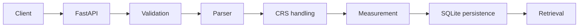

# Geospatial File Measurement API

Upload KML or a zipped Shapefile and retrieve persisted geometry, attributes and
CRS-aware measurements through FastAPI. Polygons receive area in square metres,
lines receive length in metres, and points retain null measurements.

## Problem

Geospatial files use different coordinate systems and can contain malformed or
unsupported features. This service validates the input, calculates horizontal
measurements in a suitable local projection, and stores explicit results for each
feature so they can be retrieved without reparsing the file.

## Key Features

- KML 2.2 and one zipped Shapefile dataset with a required `.prj`.
- Polygon/MultiPolygon area and LineString/MultiLineString length.
- Source geometry, feature ID/index, properties, source CRS and measurement CRS.
- Point/MultiPoint outcomes without invented area or length.
- Persistent metadata, paginated measurements and individual feature errors.
- Bounded processing, safe XML/ZIP handling, temporary-file cleanup and atomic writes.
- Swagger/OpenAPI, deterministic samples, Docker and 151 automated tests.

## Quick Start

Use Python 3.12 to reproduce the tested environment:

```bash
git clone https://github.com/PranayAkuthota/Aereo.git
cd Aereo
python3.12 -m venv .venv
source .venv/bin/activate
python -m pip install -r requirements-dev.lock
uvicorn app.main:app --reload
```

Open **Swagger at `/docs`** (`http://127.0.0.1:8000/docs`). ReDoc is `/redoc` and the schema is
`/openapi.json`. No database server or credentials are required; SQLite is created
on startup. On Windows, activate with `.venv\Scripts\activate`.
Use `requirements.lock` for a runtime-only installation.

### Docker option

```bash
docker compose up --build -d
docker compose ps
docker compose logs api
```

Compose binds port 8000 to loopback, runs one worker as a non-root user, and limits
the container to 512 MiB and one CPU. The named `measurements` volume retains
results when containers are recreated. `/health/` checks database readiness.

```bash
docker compose down      # keeps the database volume
# docker compose down -v # deletes the database volume too
```

The image uses a digest-pinned Python 3.12 base and exact dependency versions.
GDAL is not required on the host. For networks with a private CA, see the
[engineering report](docs/engineering-report.md#runtime-and-dependencies).

## Architecture



FastAPI admits a bounded upload before multipart parsing. The parser validates
its structure and produces source-CRS features; supported lines and polygons are
projected and measured. File metadata and all feature results are committed in
one SQLite transaction before returning HTTP 201. Retrieval reads persisted
metadata or an ordered page. Parsing and measurement run in a worker thread.

## Key Engineering Decisions

- **FastAPI:** typed request/response models, automatic OpenAPI documentation and
  a lightweight HTTP layer suited to the assignment.
- **CRS-aware measurements:** longitude/latitude are angular coordinates; supported
  measurable geometries are transformed to a local UTM/UPS grid before calculating
  metric area or length.
- **SQLite:** self-contained persistent storage with transactional consistency.
- **Atomic persistence:** metadata and measurements share one transaction, so input
  rejection or a failed write leaves no partial resource.
- **Input safety:** file, archive, XML, feature, coordinate and result limits bound
  processing; malformed inputs return controlled errors.
- **Explicit format readers:** PyShp, defusedxml, Shapely and pyproj keep ingestion,
  geometry operations and transformations separate without a GDAL driver stack.

## API

Success responses are resource objects; errors use a consistent `error` object.
Upload with exactly one multipart file field **`file`**, without other fields. MIME types are not trusted; the selected
parser validates content as well as the filename extension.

| Method | Endpoint | Result |
| --- | --- | --- |
| POST | `/api/files/` | Process synchronously; 201 with metadata and `Location` header |
| GET | `/api/files/{id}/` | 200 with persisted file metadata |
| GET | `/api/files/{id}/measurements/` | 200 with paginated feature results |
| GET | `/health/` | 200 when the database can be queried |

```bash
curl -sS -F 'file=@examples/polygon.kml' http://127.0.0.1:8000/api/files/
curl -sS -F 'file=@examples/sample_shapefile.zip' http://127.0.0.1:8000/api/files/
# Replace FILE_ID with the UUID returned by the upload:
curl -sS http://127.0.0.1:8000/api/files/FILE_ID/
curl -sS 'http://127.0.0.1:8000/api/files/FILE_ID/measurements/?offset=0&limit=100'
```

Example metadata (IDs and timestamps vary):

```json
{
  "id": "ea99d272-94a5-46ef-a9e3-73a2f2f07708",
  "filename": "sample_shapefile.zip",
  "file_type": "shapefile",
  "feature_count": 1,
  "crs": "EPSG:32643",
  "status": "COMPLETED",
  "measured_count": 1,
  "skipped_count": 0,
  "failed_count": 0,
  "created_at": "2026-10-08T12:00:00Z",
  "completed_at": "2026-10-08T12:00:00Z"
}
```

A feature result from that dataset:

```json
{
  "index": 0,
  "feature_id": "0",
  "geometry_type": "Polygon",
  "source_geometry_type": "POLYGON",
  "geometry": {
    "type": "Polygon",
    "coordinates": [[[500000,1900000],[500000,1900100],[500100,1900100],
                     [500100,1900000],[500000,1900000]]]
  },
  "properties": {"label": "synthetic"},
  "source_crs": "EPSG:32643",
  "measurement_crs": "EPSG:32643",
  "status": "MEASURED",
  "area": 10000.0,
  "area_unit": "m²",
  "length": null,
  "length_unit": null,
  "error": null
}
```

The measurements endpoint wraps features in
`{"file_id": "…", "total": 1, "offset": 0, "limit": 100, "features": [...]}`.
`limit` defaults to 100, permits 1–1000, and `offset` must be non-negative.
An offset beyond the total, including very large integers, returns an empty
page without binding the offset to SQLite. Geometry coordinates remain in
the **source CRS**; their JSON shape follows GeoJSON geometry conventions, but a
projected geometry should not be treated as RFC 7946 WGS84 GeoJSON.
KML IDs use the Placemark ID or a zero-based index. Shapefile IDs retain original
record ordinals; deleted DBF rows are omitted, so indices may have gaps.
`source_geometry_type` preserves the original type independently of normalization.

## CRS and Measurement

KML uses WGS84 longitude/latitude (EPSG:4326). Shapefiles require matching
SHP/SHX/DBF/PRJ components; the PRJ defines the source CRS and optional CPG defines
text encoding. Missing CRS is rejected rather than guessed.

For lines and polygons, the service transforms coordinates to WGS84 for location
and extent checks, chooses a centroid-based UTM zone and hemisphere (or UPS for
wholly polar features), then transforms the original geometry directly into that
metric CRS. Transformers use `always_xy=True` and disable ballpark operations.
Each response records its source CRS and, when measured, its measurement CRS.

Shapely measures projected polygon area with holes subtracted and multipart areas
summed; line lengths are summed across parts. Point/MultiPoint features validate
location but have null measurements and no measurement CRS. Output geometry stays
in the source CRS and is normalized to XY; Z/M do not contribute to measurements.
Invalid polygons are reported rather than silently repaired.

Results are horizontal grid measurements, with projection distortion, not
survey-certified values. Measurable features spanning more than 6° in longitude
or latitude, typical antimeridian crossings, and UTM/UPS boundary crossings are
rejected. The standard longitude-based UTM rule does not implement Norway/Svalbard
exceptions. Source area-of-use is not separately enforced, optimal datum grids
are not guaranteed, and edges are not densified.

## Persistence and Outcomes

SQLite stores `files(id, metadata)` and
`features(file_id, feature_index, result)`. Typed JSON holds the API objects;
parameterized queries and the composite feature key support ordered pagination.
Connections are short-lived, use foreign keys, WAL mode and a 10-second busy timeout.
Raw uploads are not retained.

A resource exists only after its transaction commits. `COMPLETED` means processing
finished, including any feature-level `ERROR` or `UNSUPPORTED` outcomes; inspect
`measured_count`, `skipped_count` and `failed_count`. Supported points are
`NOT_APPLICABLE`. There are no persisted pending or failed job resources.

A disconnected client's running thread can still commit a complete resource,
while its admission slot remains held until completion. The client may lose the
returned ID; retries are not idempotent. Atomic writes do not guarantee delivery
to the client or experimentally verified power-loss durability.

## Input Safety and Error Handling

- Upload/body bounds and at most two admitted uploads per process by default;
  excess capacity returns `PROCESSING_BUSY` (503) before multipart parsing.
- ZIP traversal, absolute paths, symlinks, encryption, duplicate names and excessive
  expansion/ratios are rejected. Selected components have CRC and compressed
  end-marker checks; nothing is extracted to disk.
- Safe incremental XML parsing blocks DTDs/entities, enforces complexity limits
  and clears processed nodes. Referenced resources are not fetched.
- SHP/SHX counts, record identity, offsets, lengths and coordinate arrays are checked
  before allocation. Multipart starts must begin at zero, increase strictly and
  cover non-empty ranges within the coordinate count.
- Unsupported XML encodings and invalid ZIP filename encodings return controlled
  input errors. Structural corruption rejects the dataset rather than silently
  changing geometry or retaining partial results.
- Multipart spools are explicitly closed on success, rejection, disconnect and
  cancellation. Finite values, units, outcomes and counters are validated before
  persistence; serialized feature results have a total byte budget.
- Error responses hide internal tracebacks. Logs contain IDs/counts and statuses,
  without raw uploaded content or attribute values.

```json
{"error": {"code": "MISSING_CRS", "message": "Shapefile requires a matching .prj; CRS is not guessed."}}
```

| Status | Meaning |
| --- | --- |
| 400 | Malformed/unsafe input, empty dataset or missing/invalid CRS |
| 404 | Unknown file UUID |
| 413 | A configured input or result limit was exceeded |
| 415 | Unsupported extension or non-multipart content type |
| 422 | Missing file, invalid UUID or pagination parameter |
| 500 | Unexpected server failure with a generic client response |
| 503 | Upload capacity busy |

These are bounded local safeguards, not a full production security audit.
Ancillary ZIP members receive path/size checks but are not decompressed or
CRC-validated. Private Starlette/CPython adapters require regression checks on
upgrades. Public deployment would require access controls and a retention policy.

## Samples and Demo

The checked-in [examples](examples/) are synthetic:

| File | Expected outcome |
| --- | --- |
| `polygon.kml` | MEASURED Polygon; approximately 11,804.99384 m² |
| `lines.kml` | MEASURED LineString; approximately 106.57758 m |
| `points.kml` | NOT_APPLICABLE Point; null measurements |
| `sample_shapefile.zip` | MEASURED Polygon; 10,000 m² in EPSG:32643 |

With the server running:

```bash
python scripts/demo.py
```

The script uploads all four examples, retrieves metadata and measurements,
checks consistency and prints JSON. Each run creates four new resources.
[samples/survey.kml](samples/survey.kml) demonstrates a polygon, line and point in
one upload. Sample ZIPs are intentional Shapefile inputs.

## Testing

```bash
source .venv/bin/activate
pytest -q
ruff check .
ruff format --check .
mypy app scripts
python -m pip check
```

**151 tests pass**, covering valid KML/Shapefiles, geographic/projected CRS,
polygon area and holes, line length, multipart geometry, invalid/unsupported
features, ZIP/XML safety, pagination, persistence, atomic transactions, upload
cancellation and spool cleanup. Fifteen regression cases cover malformed part
starts, unsupported XML encodings, ZIP filename encoding and valid counterparts.
Tests use synthetic inputs and temporary databases; numerical checks include
known metric dimensions and independent `pyproj.Geod` references.

The [CI workflow](.github/workflows/checks.yml) runs lint, formatting, type checks,
dependency consistency, tests and a Docker build. The published implementation's
Checks run passed. Container validation also covered health, Swagger, sample API
flows and unchanged results after recreation with the named volume retained.

## Environment variables

Defaults work without configuration. Native Python runs read exported variables;
they do **not** automatically read `.env`. Compose reads `.env` for the limit values.
See `.env.example`.

| Variable | Default | Purpose |
| --- | --- | --- |
| `AEREO_DATABASE_PATH` | `.data/aereo.sqlite3` | SQLite file; parent directories are created |
| `AEREO_MAX_UPLOAD_BYTES` | `10485760` | Maximum uploaded file size (10 MiB) |
| `AEREO_MAX_EXPANDED_BYTES` | `52428800` | Maximum total declared ZIP expansion (50 MiB) |
| `AEREO_MAX_FEATURES` | `10000` | Maximum features per file |
| `AEREO_MAX_COORDINATES` | `100000` | Maximum coordinates per file |
| `AEREO_MAX_XML_ELEMENTS` | `200000` | XML start elements, including ignored content |
| `AEREO_MAX_RESULT_BYTES` | `33554432` | Sum of UTF-8 serialized feature JSON bytes (32 MiB) |
| `AEREO_MAX_CONCURRENT_UPLOADS` | `2` | Uploads admitted per process, before multipart parsing |

All limit settings must be positive integers. Additional fixed limits are 100
ZIP entries, a 200:1 compression ratio per entry, XML depth 64, coordinate tokens
of 128 characters, PRJ size 64 KiB and CPG size 128 bytes. The HTTP body permits
64 KiB of multipart overhead beyond the file limit. Pages permit 1–1000 features.
The result budget covers UTF-8 feature JSON, not metadata or the page wrapper.

## Project Structure

```text
app/          HTTP layer, schemas, upload orchestration and SQLite repository
  geospatial/ KML/Shapefile parsing, CRS selection and measurement
tests/        API, numerical, safety, cleanup and persistence tests
examples/     Single-feature deterministic demo inputs
samples/      Mixed survey and projected-square fixtures
scripts/      Standard-library API demo
docs/         Engineering design and interview walkthrough
.github/      CI workflow
```

See the [engineering report](docs/engineering-report.md) for design details and
[interview guide](docs/interview-guide.md) for a code walkthrough and exercises.

## Limitations and Future Work

Supported KML is a subset: KMZ, styles, 3D measurements and mixed collections are
not measured. Shapefile MultiPatch is unsupported. DBF text defaults to UTF-8
without CPG; malformed attributes reject the dataset.

Parsing and results remain in memory within input/concurrency limits. These
limits are not an exact RSS bound; DBF attribute expansion has no separate field
count limit. SQLite and one worker suit local evaluation. Authentication,
retention/deletion, deduplication, distributed admission and durable background
jobs are not implemented.

Useful next steps would address demonstrated needs: densification/geodesic
measurement for broader extents, idempotency and retention for recovery, or
external storage and durable workers for larger workloads.

## Learning and Development

The key lessons are separating coordinate units from ground measurements,
keeping axis order explicit, preserving Shapefile geometry/attribute association,
and treating structurally valid XML as distinct from valid geometry.
AI assistance was used for implementation, test design and documentation.
